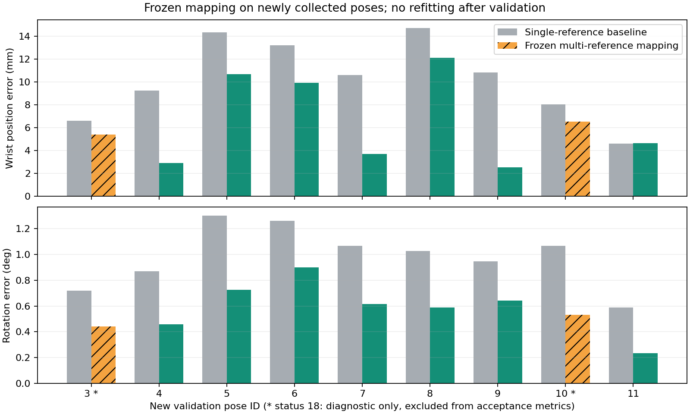

# 左腕 Tracker—TRON2 刚体映射：2026-10-27 最终结果

已完成广域采样及冻结矩阵后的新姿态验收，位置和旋转均已求解。最终新姿态位置 RMSE **7.642 mm**，旋转 RMSE **0.625°**。这是当前采样范围内约 1 cm 级的系统一致性；**没有达到此前 5 mm RMSE 标准，也没有外部计量设备证明绝对精度**。

完整精度矩阵保存在 [calibration.json](calibration.json)。回放命令现支持显式加载该文件，准备姿态保持原定义。

**用户验收：**2026-10-27 用户确认“1cm我觉得可以接受”，本组矩阵已记录为当前地图与安装下接受的标定结果，见 [acceptance.json](acceptance.json)。接受的是上述实测精度（位置 RMSE 7.642 mm、最大 12.099 mm），不是所有误差均小于 10 mm 的保证；原 5 mm 数值检查结果和冻结矩阵保持原样。

## 本轮采集与验证

- 从用户确认的初始姿态完成七个空间位置的广域采样，共 36 组、695 对记录；肩、肘、三个腕关节均参与。运动拆分为 251 段 MoveJ。
- 左臂七关节实际覆盖跨度依次约为 `85.49°, 63.70°, 84.02°, 68.49°, 101.25°, 67.04°, 75.77°`，并非只移动末端一个关节。
- 与此前同地图、同安装的三轮数据整合，使用 **47 个拟合组**求解。历史留出组全部未进入拟合。
- 冻结矩阵后，另采三个新空间位置的 **9 个全新混合旋转姿态**。其中 7 个完整 `status=2` 组用于最终误差评价；另外 2 组含原始 `status=18`，保留作诊断，不计入正常跟踪精度。起点、过渡点、返回点也不计入精度。
- 全部运动完成并返回本轮初始姿态；最终返回的最大关节误差约 0.659°，只读检查时关节速度均为零。右臂与头部目标保持不变，最终验证过程最大实测偏移约 0.00574°。
- 原 Tracker 采集进程及连接保留；使用被动 HID 读取，没有设备写入或地图重建。结束检查仍收到正常跟踪数据。

## 求解方法与 DexUMI 的关系

参考本机 `project1yu/DexUMI-main/real_script/calibration/compute_ur5_iphone_offset.py` 的相对刚体关系及六参数优化：

```text
T_WT = T_WB @ T_BE @ T_ET
```

沿用其位置与旋转向量联合残差，本次把单个参考姿态扩展为全部拟合组的多参考约束，再仅用拟合组估计世界坐标变换。不是逐轴尝试符号，不添加距离 scale，不叠加猜测的 90° 补偿。该多参考扩展与原版单参考实现不同，已通过新采集的独立姿态比较效果。

原始 DexUMI 单参考解在相同 7 组新姿态上的位置 RMSE 为 11.530 mm、旋转 RMSE 为 1.034°；最终多参考解分别为 7.642 mm、0.625°。

矩阵在新姿态采集前冻结，验收后没有重新拟合。`calibration.json` 保留冻结时的 `frozen_candidate_pending_new_validation` 字段以保持文件与哈希不变；最终验收事实另见 [final_validation.json](final_validation.json) 与 [独立复算](independent_review.json)。该字段并不表示没有做验收，也不表示通过了 5 mm 标准。

冻结 SHA256：

```text
2ce763663898c62971733ce4d2e53e5adc5d6c0c66a3d60c5d60d5f756e0ace5
```

## 精度

| 数据集合 | 组数 | 腕部位置 RMSE | 位置最大误差 | 旋转 RMSE | 旋转最大误差 |
|---|---:|---:|---:|---:|---:|
| 拟合组 | 47 | 8.039 mm | 16.285 mm | 0.495° | 1.046° |
| 历史留出组（方法比较阶段） | 20 | 9.263 mm | 13.258 mm | 0.517° | 1.120° |
| 冻结后全新正常跟踪姿态 | 7 | **7.642 mm** | **12.099 mm** | **0.625°** | **0.898°** |

误差对比的是：Tracker 经安装补偿后预测的腕部原点，与机器人实测关节角经官方模型正解得到的同一腕部原点。它不是直接比较 Tracker 和腕部两个不同原点的移动距离。机器人正解本身也有模型和关节零位误差，不能把此处残差全部归因于 Tracker。



图中橙色斜线为含 `status=18` 的诊断组，未计入上表最后一行。

## 坐标与矩阵

使用列向量，`T_AB` 表示把 B 系坐标变换到 A 系；位置单位为 **米**，旋转矩阵为主动旋转。

- `B`：机器人 `base_Link`。
- `W`：本次未重建的 Tracker 世界地图。
- `T`：Tracker 自身坐标系，按本次确认的 HID 四元数约定解释。
- `E`：SDK 左腕虚拟 TCP。
- `F`：零偏移实际法兰模型坐标系 `wrist_roll_L_Link`。

Tracker 世界系到机器人基座的 `T_BW`：

```text
[-0.996740677  -0.011608933   0.079832670   0.391214870]
[ 0.079914414  -0.006756143   0.996778832   0.472974396]
[-0.011032178   0.999909790   0.007661843   0.158691814]
[ 0             0             0             1          ]
```

Tracker 到 SDK 腕部的安装变换 `T_ET`：

```text
[ 0.998394038   0.033645550  -0.045577637   0.014918874]
[ 0.022207426  -0.972581172  -0.231500960   0.040804039]
[-0.052116928   0.230117016  -0.971766425   0.160023053]
[ 0             0             0             1          ]
```

若使用零偏移实际法兰，安装变换为 `T_FT`：

```text
[ 0.998394038   0.033645550  -0.045577637  -0.018881126]
[ 0.022207426  -0.972581172  -0.231500960   0.040804039]
[-0.052116928   0.230117016  -0.971766425  -0.052476947]
[ 0             0             0             1          ]
```

SDK TCP 在法兰下的偏移为 `[-0.0338, 0, -0.2125] m`，因此 `T_ET` 的平移不能直接解释为法兰到 Tracker 的物理安装距离。

## 使用方式

已经正确解码的 Tracker 位姿 `T_WT` 转换成腕部位姿：

```python
import json
import numpy as np

with open("tracker_calibrations/left_mapping_final_20261027/calibration.json") as f:
    cal = json.load(f)

T_BE = np.asarray(cal["T_BW"]) @ T_WT @ np.linalg.inv(np.asarray(cal["T_ET"]))
position_m = T_BE[:3, 3]
rotation_matrix = T_BE[:3, :3]
```

`T_WT` 必须是正确约定下的 Tracker 位姿。对于本项目旧采样保存的四元数，**不能忽略以下格式处理**：

本次求解采用 `tracker_quaternion_convention="raw-xyzw"`。旧 pyvut 保存的 WXYZ 数组 `q` 与原始 HID 字段的排列不同；本次配对验证对应的正确 WXYZ 为 `[q[1], q[0], q[3], q[2]]`。原样本没有改写。对旧保存位姿矩阵可调用：

```python
from dexumi_wrist_solver import wrist_from_tracker

T_BE = wrist_from_tracker(T_WT_stored, cal)
```

该函数先按标定文件显式纠正旧保存格式，再进行矩阵变换。对于已经正确解码的标准四元数，不要再次进行这一步。不要把此格式修正无条件套到其它 SDK 或所有历史 HDF5 数据。

应用矩阵后无需再叠加旧的 `axis-map=y,z,x`。安装平移已处理旋转造成的杠杆臂位移：`p_BT = p_BE + R_BE @ t_ET`，因此 Tracker 与腕部原点的移动距离可以不同。

## 适用范围与保存内容

矩阵适用于本次地图、机器人基座位置及左腕 Tracker 安装关系。Tracker 重装需重新核验 `T_ET`；地图重建或机器人基座相对地图移动需重新核验 `T_BW`。以前真人腕部录制数据的安装关系不能默认等于本次机器人法兰安装关系。

本次结果尚未证明带 O6 负载时的动态跟踪精度、ServoP 执行误差或抓取精度。

**回放接入更新：**`--tracker-calibration calibration.json` 已接入两个回放命令行入口。
对旧真人腕部 episode 65，用户确认地图与底座朝向未变；命令使用 `R_BW` 进行相对轴向转换，
不套用机器人安装 `T_ET`，仍以准备姿态为起点。这与上面的同安装完整腕位姿转换是两种不同用途。
旧采样用 `--tracker-quaternion pyvut-legacy` 显式处理保存排列。原始矩阵及验收哈希不变，
冻结文件中的 `applied_to_replay=false` 是冻结时状态，CLI 实际转换由运行日志记录。
本次只完成代码与离线预检，没有发送回放运动；详见 [回放命令](../../tron2_tracker_replay_commands.md)。
源文件校验值、地图朝向确认与离线目标范围见 [接入记录](replay_integration.json)。

- [完整矩阵与 47 组拟合来源](calibration.json)
- [广域运动计划](broad_plan.json)、[采集完成统计](broad_execution.json)
- [全新验证运动计划](final_validation_plan.json)、[结果及逐组误差](final_validation.json)
- [独立算法复算与冻结哈希核对](independent_review.json)
- [历史交叉验证](historical_cross_validation.json)、[拟合敏感性](fit_sensitivity.json)
- [完成时机器人与 Tracker 只读检查](completion_check.json)
- [广域原始配对样本](../broad_20261027_230150_0285f444/20261027_230152_25bc98b9/samples.jsonl)
- [冻结后新姿态原始配对样本](../final_validation_20261027_231813/20261027_231814_43fd39f2/samples.jsonl)
- [完成时实际头部相机图像](../../camera_alignment_results/calibration_complete_20261027/top_raw.png)
